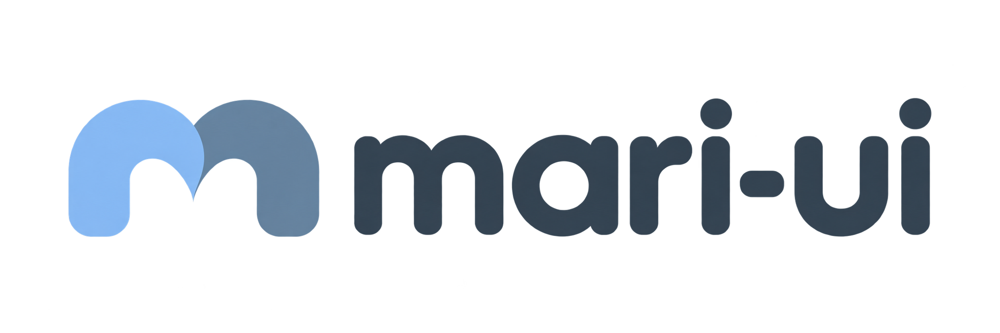

# mari-ui



Türkçe, token tabanlı, framework'ten bağımsız React tasarım sistemi. Web (React / Next.js, RSC uyumlu) ve React Native aynı token ve prop sözleşmesinden beslenir; renk, tipografi, boşluk tek kaynaktan (`@mari-ui/tokens`) türer, açık ve koyu tema WCAG AA kontrastıyla otomatik hesaplanır.

- **70+ component** — form, gezinme, veri gösterimi, grafikler, geri bildirim; her biri iskelet (`skeleton`), erişilebilirlik testi, açık/koyu tema ve mobil yerleşimle.
- **Tema** — `mari-ui.config.json` ile marka rengi, font, köşe ve boşluk yoğunluğu; tema stüdyosunda canlı düzenleme; son kullanıcı için `ThemeCustomizer`.
- **AI ajan kuralları** — `@mari-ui/cli`, kütüphanenin gerçek prop sözleşmesinden Claude Code, Codex, Cursor, Gemini ve Copilot için kural dosyaları üretir.

## Hızlı başlangıç

```bash
pnpm add @mari-ui/components @mari-ui/core @mari-ui/tokens
```

```tsx
// Global CSS giriş noktanızda (ör. app/layout.tsx, main.tsx)
import "@mari-ui/tokens/fonts.css"; // isteğe bağlı: Geist / Manrope / Geist Mono yerel fontları
import "@mari-ui/components/styles.css";

import { Button } from "@mari-ui/components/button";

<Button color="primary">Kaydet</Button>;
```

Projenizde Tailwind kurulu olması gerekmez; `styles.css` derlenmiş haldedir. Ayrıntılı kurulum (Next.js App Router, Vite, tema, koyu mod, AI kuralları) Storybook'taki **Başlarken** bölümünde.

## Paket grafiği

```
apps/
  docs/        Storybook — component ve kullanım dokümantasyonu
  studio/      Tema stüdyosu (Next.js) — renk/font/yoğunluk canlı düzenleme, mari-ui.config.json dışa aktarma
packages/
  tokens/      @mari-ui/tokens       platform-agnostic tek token kaynağı, tema çözümleme, tema kalıcılığı
  core/        @mari-ui/core         headless mantık: cn(), variant tabloları, paylaşılan eksen tipleri
  components/  @mari-ui/components   web component'leri (her biri ayrı subpath: @mari-ui/components/button)
  native/      @mari-ui/native       React Native component'leri (Button, Input, Card, List)
  cli/         @mari-ui/cli          init / sync / theme — tema üretimi ve AI ajan kuralları
  modules/     (iskelet)             sayfa modülleri — backend sözleşmesi netleşince
  tsconfig/, eslint-config/          paylaşılan yapılandırma (yayınlanmaz)
```

Bağımlılık yönü tek yönlü: `tokens → core → {components, native}`; `cli` ve `studio` hepsini okur. Mimari ayrıntılar: [docs/architecture.md](docs/architecture.md).

## Geliştirme

```bash
pnpm install
pnpm build        # tüm paketler (turbo)
pnpm storybook    # http://localhost:6006
pnpm test
pnpm lint
pnpm typecheck
```

Node ≥ 20, pnpm. Katkı süreci ve yeni component kontrol listesi: [CONTRIBUTING.md](CONTRIBUTING.md). Erişilebilirlik ve güvenlik: [ACCESSIBILITY.md](ACCESSIBILITY.md), [SECURITY.md](SECURITY.md).

## Durum

Paketler `0.1.0`; henüz npm'e yayınlanmadı ve bir sürüm/yayın süreci (changesets vb.) kurulmadı. CI her PR'da build, lint, tip kontrolü, test ve bağımlılık taramasını çalıştırır.
